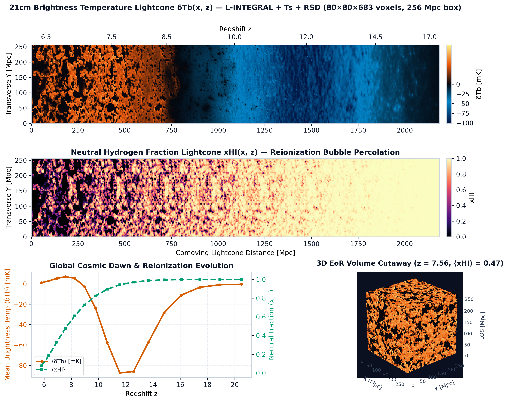
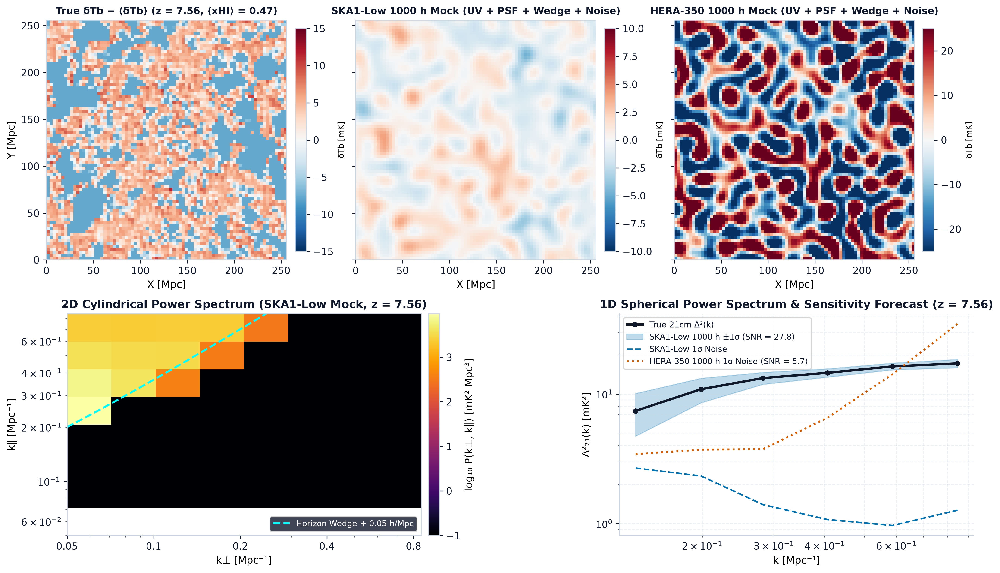
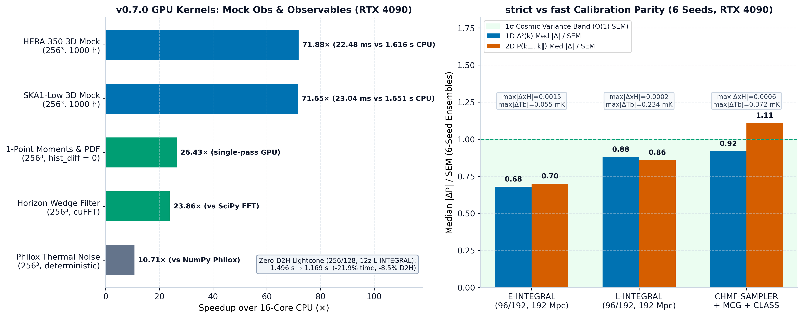
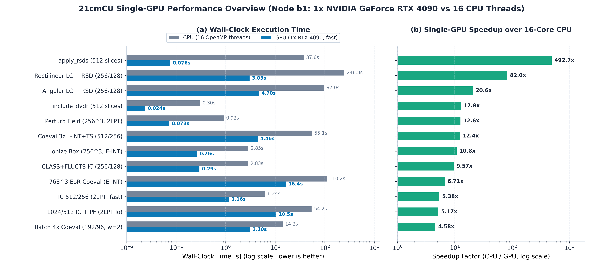
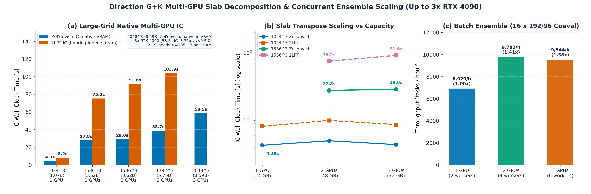

# 21cmCU

**Native C/CUDA + cuFFT 21cm Cosmological Simulation Engine for 21cmFAST v4 — Zero CuPy or Numba Dependency**


[](https://github.com/HainaHuang729/21cmCU/actions/workflows/ci.yml)


[Visual Showcase](#visual-showcase) · [Quickstart](#5-minute-quickstart) · [Wiki](docs/wiki/Home.md) · [User Guide](docs/USER_GUIDE.md) · [Benchmarks](docs/BENCHMARKS.md) · [Upstream & CPU Opt](docs/UPSTREAM_AND_OPTIMIZATION.md) · [Methods Paper](docs/paper/21cmcu_paper.md) · [Examples](examples/)

---

**21cmCU** embeds custom CUDA kernels, cuFFT pipelines, device-resident field caching, GPU HDF5 compression, and multi-GPU slab domain decomposition directly inside the `c_21cmfast` CFFI shared library, with full `py21cmcu` / `py21cmfast` v4 API and CLI compatibility. It accelerates both high-throughput simulation-based inference (SBI) ensembles and out-of-single-GPU multi-billion-voxel boxes (`1536³–2048³`).

---

## Visual Showcase

<p align="center">
  
</p>

*Panoramic `L-INTEGRAL + Ts + RSD` 21cm brightness temperature & neutral hydrogen fraction lightcone (`256 Mpc`, $z = 6.3\text{–}17.5$), global Cosmic Dawn absorption & reionization history, and 3D EoR volume cutaway at $z = 7.56$ ($\langle x_{\mathrm{HI}} \rangle = 0.47$).*

<p align="center">
  
</p>

*Single-pass interferometer mock pipeline (`py21cmcu.instrument`): true 21cm fluctuations at $z = 7.56$ vs `SKA1-Low` (1D `SNR = 27.8`) & `HERA-350` (1D `SNR = 5.7`) 1000 h mocks (UV coverage, PSF, channel width, horizon wedge, $P_N$ thermal noise), 2D cylindrical $P(k_\perp, k_\parallel)$, and 1D $\Delta^2_{21}(k)$ sensitivity forecast.*

<p align="center">
  
</p>

*Verified `v0.7.0` RTX 4090 observables/mock speedups (`71.65×–71.88×` on `256³` mocks, `23.86×–26.43×` on wedge/PDF kernels, `-21.9%` zero-D2H lightcone wall time) alongside 6-seed `strict` vs `fast` statistical calibration parity.*

---

## Performance Highlights (`v0.6.0–v0.7.0` on NVIDIA RTX 4090 vs 16-Core CPU)

All timings were measured directly on `b1`/`b6` GPU nodes (`N_THREADS=16` CPU vs `1×–3× RTX 4090`, CUDA 12.6, `sm_89`):

| Workload | Grid / Setup | CPU (16T) | `21cmCU` GPU (`fast`) | Speedup |
| --- | --- | ---: | ---: | ---: |
| `apply_rsds` | `128 × 128 × 512` | `37.6455 s` | `0.0764 s` (`1× 4090`) | **`492.74×`** |
| Rectilinear Lightcone (`+ dvdr + RSD`) | `256 / 128`, `z=6.5–11` | `248.773 s` | `3.032 s` (`1× 4090`) | **`82.05×`** |
| `SKA1-Low / HERA-350` 3D Mock Obs | `256³` single-pass FFT+noise | `1.651 s / 1.616 s` | `23.04 ms / 22.48 ms` | **`71.65× / 71.88×`** |
| 1-Point Moments+PDF / Wedge Filter | `256³` | — | `26.43× / 23.86×` vs CPU | **`26.43× / 23.86×`** |
| `AngularLightconer` (`+ dvdr + RSD`) | `256 / 128`, `z=7.8–9.8` | `97.018 s` | `4.698 s` (`1× 4090`) | **`20.65×`** |
| Coeval 3z (`L-INTEGRAL + TS`) | `512 / 256`, `z=12,10,8` | `55.079 s` | `4.456 s` (`1× 4090`) | **`12.36×`** |
| EoR Coeval (`E-INTEGRAL`) | `768³`, `z=7.0` | `110.209 s` | `16.435 s` (`1× 4090`) | **`6.71×`** |
| `DeviceLZF` HDF5 Write | `256 × 256 × 512` (`256 MB`) | `259.6 MB/s` (`h5py`) | **`476.3 MB/s`** (`1× 4090`) | **`1.83×`** |
| `CUDA_LAZY_D2H` Residency | `512 / 256` 3z coeval | `4.477 s` / `7,114 MB` | **`3.904 s` / `5,570 MB`** | **`-12.8%` time / `-21.7%` D2H** |
| Zero-D2H Lightcone (`lazy_d2h=True`) | `256 / 128`, 12z `L-INTEGRAL` | `1.496 s` (`lazy_d2h=False`) | **`1.169 s`** (`1× 4090`) | **`-21.9%` time / `-8.5%` D2H** |
| **`2048³` (`8.590 B` voxels) Zel'dovich IC** | `3× RTX 4090` (native VRAM) | `216.665 s` (`v0.5.0` host) | **`58.467 s`** (`64.282 s` w/ PF+PS) | **`3.71×`** |
| SBI Concurrent Ensemble (`run_batch`) | `16 × 192/96`, `2× RTX 4090` | — | `5.888 s` (**`9,782.0 tasks/h`**) | **`1.41×` vs 1 GPU** |

<p align="center">
  
</p>
<p align="center">
  
</p>

> Full stage-by-stage tables, `1024³–2048³` multi-GPU scaling, and I/O plots are documented in [docs/BENCHMARKS.md](docs/BENCHMARKS.md) and [docs/paper/21cmcu_paper.md](docs/paper/21cmcu_paper.md).

---

## 5-Minute Quickstart

### 1. Install (Local Source, Docker, or HPC Apptainer)

```bash
# Option A: One-command installer (checks Python >=3.12, headers, gcc, GSL, FFTW3f, CUDA, then runs `21cmcu doctor`)
git clone https://github.com/HainaHuang729/21cmCU.git
cd 21cmCU
./scripts/install.sh

# Option B: Docker
docker build -f docker/Dockerfile -t 21cmcu:0.7.0 .
docker run --rm --gpus all 21cmcu:0.7.0 doctor

# Option C: Apptainer / Singularity (Slurm clusters)
apptainer build 21cmcu.sif docker/21cmcu.def
apptainer run --nv 21cmcu.sif doctor
```

Verify your GPU runtime, PCIe/NVLink topology, libraries, and grid sizing limits anytime with:

```bash
21cmcu doctor
```

### 2. Minimal Python Example

```python
import py21cmcu as p21

# One-line GPU lightcone + SKA1-Low mock + offline interactive 3D WebGL2 HTML viewer:
lc = p21.quick_lightcone(
    z_min=7.5, z_max=11.5, box_len=128.0, dim=128, hii_dim=64,
    instrument="SKA1-Low", html_3d_path="lightcone_3d.html",
)
ps1 = p21.power_spectrum_1d(lc.lightcones["brightness_temp"][:, :, :64], box_length=128.0, n_bins=12, remove_mean=True)

# Or full InputParameters control with zero-D2H GPU residency:
inputs = p21.InputParameters(
    random_seed=42,
    node_redshifts=[8.0, 9.5, 11.0, 12.5],  # > Z_HEAT_MAX when USE_TS_FLUCT=True
).evolve_input_structs(
    DIM=128,
    HII_DIM=64,
    BOX_LEN=128.0,
    SOURCE_MODEL="L-INTEGRAL",
    USE_TS_FLUCT=True,
    Z_HEAT_MAX=12.0,
)

with p21.use_mode("fast", lazy_d2h=True):
    coeval = p21.run_coeval(inputs=inputs, out_redshifts=[8.0], write=False)[0]
    torch_tb = p21.to_torch(coeval.brightness_temp_struct)  # zero-copy DLPack GPU tensor
```

### 3. CLI & Runnable Examples (`examples/`)

```bash
# Single CLI runs with GPU enabled:
P21_USE_CUDA=1 P21_CUDA_MODE=fast 21cmcu run coeval -z 8 --template simple tiny --out ./out

# Resumable SBI Sobol sweep with horizon wedge filtering & thermal noise:
21cmcu batch --sobol-samples 16 --mode lightcone --redshifts 6.5,8.0,9.5 \
  --devices 0,1 --workers-per-gpu 2 --wedge-filter --noise-sigma-mk 2.0 --resume --out sbi.h5
```

| Example | Description | Verified RTX 4090 Runtime |
| --- | --- | --- |
| [01_quickstart_coeval.py](examples/01_quickstart_coeval.py) | Minimal single-GPU `L-INTEGRAL + TS` coeval + 1D $P(k)$ | `0.556 s` (`64³`, `584` hits) |
| [02_lightcone_power_spectrum.py](examples/02_lightcone_power_spectrum.py) | Rectilinear lightcone + RSDs + chunk PS + wedge/noise + `DeviceLZF` | `2.53 s` (`64×64×414`) |
| [03_multigpu_large_ic.py](examples/03_multigpu_large_ic.py) | Multi-GPU slab IC + Perturb + 1D $P(k)$ (`--dim 256..2048`) | `0.474 s` (2-GPU Zel) / `0.569 s` (3-GPU 2LPT) |
| [sbi_lightcone_dataset.py](examples/sbi_lightcone_dataset.py) | 4D scrambled Sobol sweep + resumable HDF5 checkpoints via `run_batch` | Smoke-verified on `b1` GPUs |
| [04_dlpack_and_sbi_inference.py](examples/04_dlpack_and_sbi_inference.py) | Zero-copy DLPack / `to_torch`, `field_moments_and_pdf`, `SBISimulator` & `Likelihood21cm` | Verified on `b6` (`RTX 4090`) |
| [05_interferometer_mock_and_forecast.py](examples/05_interferometer_mock_and_forecast.py) | `SKA1-Low` & `HERA-350` single-pass GPU 3D mocks (`>71×` at `256³`) & 1D/2D SNR | Verified on `b6` (`RTX 4090`) |
| [06_quick_lightcone_and_3d_viz.py](examples/06_quick_lightcone_and_3d_viz.py) | One-line `quick_lightcone` + mock observation + offline 3D WebGL HTML viewer | Verified on `b6` (`RTX 4090`) |
| [quickstart.ipynb](examples/quickstart.ipynb) | Interactive 5-cell Jupyter quickstart notebook | — |

---

## Core Capabilities

- **Native C/CUDA + cuFFT Core & Dual Modes (`CUDA_MODE`)**: compiled directly inside `c_21cmfast`, supporting `E-INTEGRAL`, `CONST-ION-EFF`, `L-INTEGRAL`, `DEXM-ESF`, and `CHMF-SAMPLER` with `USE_MCGS`, `CLASS` (`V_CB_MODEL="FLUCTS"`), and `LYA_MULTIPLE_SCATTERING`.
  - `strict` (default): CPU-matched parity mode (`rel_rms ~ 1e-4` on `384³ / 128³` lightcones, `< 0.02%` max 3D $P(k)$ deviation over $k \in [0.1, 1.0]\ \mathrm{Mpc}^{-1}$).
  - `fast`: parallel Philox IC RNG, GPU chunk-tree hashing, and `--use_fast_math` kernels calibrated over 6 random seeds ([docs/CALIBRATION.md](docs/CALIBRATION.md): $|\Delta \langle x_{\mathrm{HI}} \rangle| \le 0.00147$, $|\Delta \langle \delta T_b \rangle| \le 0.3719\ \mathrm{mK}$, median $|\Delta P|/\text{SEM} = 0.68\text{–}1.11$).
- **Multi-GPU Slab Domain Decomposition & Single-Slab `2048³`**: distributed Y-slab 3D cuFFT (`cuda_mgpu.cu`) with 64 MiB pinned portable host-bounce buffers, `std::thread` sub-tiled transposes, zero-`h_tmp_ab` 2LPT streaming, and single-work-slab streaming (`P21_CUDA_MGPU_SINGLE_SLAB`). Scales natively in-VRAM to `2048³` (`8.590 B` voxels) Zel'dovich IC on `3× RTX 4090` (`58.467 s`), and delivers `1.94×–3.52×` speedups on `1536³`/`1792³` over `v0.5.0`.
- **GPU Residency (`CUDA_LAZY_D2H`), `DeviceLZF` HDF5 & `CLASS` Caching**: opt-in GPU intermediate retention (`use_mode(..., lazy_d2h=True)` / `P21_CUDA_LAZY_D2H=1`) cuts `512/256` 3z D2H traffic by `21.7%`; `save_lightcone(..., compression="device-lzf")` compresses chunks on-GPU into standard HDF5 LZF (`476.3 MB/s` vs `259.6 MB/s` CPU LZF); persistent `CosmoTables` memory/disk caching eliminates repeated `CLASS` startup latency (`0.634 s → 0.311 ms` memory / `2.7 ms` disk).
- **Lightcone RSDs, Power Spectra & End-to-End SBI Pipeline**: fused GPU `include_dvdr_in_tau21`, `rsds_shift` / `apply_rsds`, `RectilinearLightconer` & `AngularLightconer` kernels, cuFFT 1D/2D power spectra, scrambled Sobol parameter sampling (`generate_sobol_parameter_grid`), GPU Fourier horizon wedge filtering (`apply_wedge_filter_3d`), Philox thermal noise (`add_thermal_noise_3d`), single-pass non-Gaussian moments & PDF (`field_moments_and_pdf`), and resumable HDF5-checkpointed `run_batch`.
- **Interferometer Mocks, Forecasts & Zero-Copy PyTorch Interop (`v0.7.0`, `82` CUDA APIs)**: single-pass GPU `mock_observation_3d` (`SKA1-Low`, `HERA-350`, `MWA-II`, `LOFAR`) with analytic or `antenna_xy_m` UV density & exact $\Omega_p \Omega_{\mathrm{eff}}$ thermal noise `P_N(k_\perp, z)`, 1D/2D SNR forecasters (`forecast_power_spectrum_error`), plus pure-`ctypes` `__dlpack__` / `__cuda_array_interface__` (`CudaFieldView`, `to_torch`), `Likelihood21cm`, and `SBISimulator`.
- **Zero-D2H Lightcones, One-Line API & Offline 3D Visualization (`v0.7.0`)**: GPU global mean reduction (`p21_cuda_field_mean_f32`), zero-D2H rectilinear slicing (`-21.9%` runtime on `256/128` `L-INTEGRAL`), $O(1)$-memory `stream_perturbed_fields=True`, `quick_coeval` / `quick_lightcone` (with causal-free `parallel_redshifts=True`), and standalone WebGL2 3D raymarching HTML viewers (`py21cmcu.viz`).
- **Engine Stability & Physics Fixes**: aligned photon-conservation redshift/neutral-fraction array lengths (`photoncons.py`), null-output safety guard in `st_taylor_factor` for `SAMPLE_METHOD="PARTITION"` (`hmf.c`), and separated previous-redshift 1D ACG efficiency table (`Nion_conditional_table1D_acg_prev`) for `E-INTEGRAL` + `USE_MCGS=True`.

---

## Hardware Sizing Guide (24 GB Class GPUs)

| Workload | Min GPUs | VRAM / GPU | Host RAM | Verified Runtime (`RTX 4090`) |
| --- | :---: | --- | --- | --- |
| `512³ -> 256³` Coeval (`L-INTEGRAL + TS`, 3z) | 1 | ~5 GB | 8 GB | `4.46 s` (`12.36×` vs 16T CPU) |
| `768³` EoR Coeval | 1 | ~19 GB | 16 GB | `16.44 s` (`6.71×` vs 16T CPU) |
| `1024³` (`1.07B`) 2LPT IC + PF | 1 | ~7–18 GB | 24 GB | `8.20 s` IC (`8.78 s` total) |
| `1536³` (`3.62B`) Multi-GPU Zel'dovich / 2LPT IC | 2 | ~15 GB | 90 GB | `27.80 s` / `75.23 s` (2 GPUs) |
| `1792³` (`5.75B`) Multi-GPU Zel'dovich / 2LPT IC | 3 | ~16 GB | 135 GB | `38.70 s` / `103.89 s` (3 GPUs) |
| `2048³` (`8.59B`) Single-Slab Zel'dovich IC | 3 | ~11.6 GB | 72 GB | `58.47 s` native in-VRAM (3 GPUs) |

---

## Documentation Hub

| Resource | Purpose |
| --- | --- |
| [Wiki (`docs/wiki/Home.md`)](docs/wiki/Home.md) | Browsable topic pages covering install, quickstart, modes, multi-GPU, SBI, API/CLI, and FAQ |
| [User Guide (`docs/USER_GUIDE.md`)](docs/USER_GUIDE.md) | End-to-end guide for builds, containers, workflows, and CLI flags |
| [Benchmarks (`docs/BENCHMARKS.md`)](docs/BENCHMARKS.md) | Full single-GPU, multi-GPU `v0.5.0 → v0.6.0`, residency, and `DeviceLZF` tables & figures |
| [Upstream & CPU Opt (`docs/UPSTREAM_AND_OPTIMIZATION.md`)](docs/UPSTREAM_AND_OPTIMIZATION.md) | Upstream 21cmFAST v4 roadmap, CPU fallbacks, CPU optimization plan, & accuracy summary |
| [Methods Paper (`docs/paper/21cmcu_paper.md`)](docs/paper/21cmcu_paper.md) | Standalone technical report ([LaTeX](docs/paper/21cmcu_paper.tex) & [BibTeX](docs/paper/refs.bib)) |
| [Calibration (`docs/CALIBRATION.md`)](docs/CALIBRATION.md) | `strict` vs `fast` numerical & 6-seed statistical parity validation |
| [Roadmap (`docs/ROADMAP.md`)](docs/ROADMAP.md) & [Changelog (`CHANGELOG.md`)](CHANGELOG.md) | Architecture notes, release history, and verification record (`168/168` GPU tests) |

Reproduce benchmarks and figures anytime via:

```bash
21cmcu bench --suite all,mgpu --json benchmarks/results_rtx4090_v060.json
python benchmarks/plot_benchmarks.py --json benchmarks/results_rtx4090_v060.json --out-dir docs/figures
python benchmarks/generate_showcase_figures.py --out-dir docs/figures
```

---

## Legacy Archive & License

- Previous CuPy adapter (`v4/`) and legacy v3 CUDA sources (`lightcone/`, `gpu/`) were removed from `main` in `v0.4.0` and remain preserved under git tag `archive-cupy-v4`.
- Upstream 21cmFAST license: [LICENSE.upstream](LICENSE.upstream).
