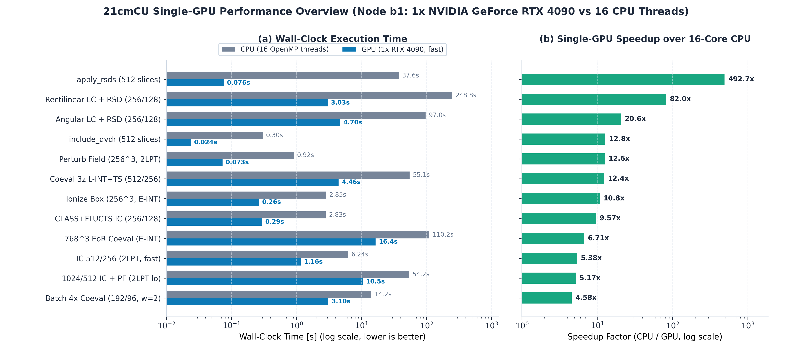
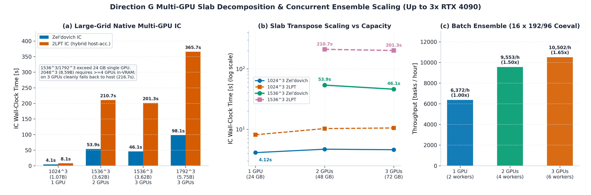
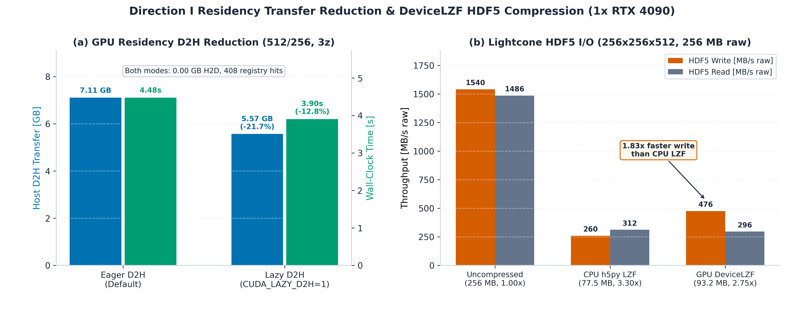

# 21cmCU Benchmark Suite (`v0.5.0` — NVIDIA RTX 4090)

All measurements in this report were captured directly on cluster node **`b1`** using [`benchmarks/bench_21cmcu.py`](../benchmarks/bench_21cmcu.py) and stored verbatim in [`benchmarks/results_rtx4090_v050.json`](../benchmarks/results_rtx4090_v050.json).

## Hardware & Environment

| Component | Configuration |
|---|---|
| Host CPU & RAM | Node `b1`, 64-core x86_64 host, **16 OpenMP threads** (`N_THREADS=16`) for CPU baselines, 192 GiB Slurm memory limit (`129.48 GiB` peak RSS) |
| GPUs | **1×, 2×, and 3× NVIDIA GeForce RTX 4090** (`24,564 MiB` VRAM per GPU, PCIe interconnect, `CUDA_ARCHS=89`) |
| Software | CUDA 12.6, native `c_21cmfast` CFFI extension, NumPy 2.5.5, `21cmCU v0.5.0` |
| Native GPU Verification | **`162/162` tests passing** (`-k "not speed"` across all 11 native test suites on `3× RTX 4090`) |

Reproduce the full sweep with:

```bash
python benchmarks/bench_21cmcu.py --suite all,mgpu --json benchmarks/results_rtx4090_v050.json
python benchmarks/plot_benchmarks.py --json benchmarks/results_rtx4090_v050.json --out-dir docs/figures
```

---

## 1. Single-GPU vs 16-Core CPU Overview



| Workload | Grid (`DIM / HII_DIM`) | CPU 16T [s] | 1× RTX 4090 (`fast`) [s] | Speedup | Notes |
|---|---|---:|---:|---:|---|
| `apply_rsds` | `128 × 128 × 512` | `37.6455` | `0.0764` | **`492.74×`** | Standalone column-parallel CIC LOS displacement |
| Rectilinear Lightcone (`+ dvdr + RSD`) | `256 / 128`, `z=6.5–11` | `248.773` | `3.032` | **`82.05×`** | `0.562 GB` H2D, `1,212` registry hits, 6 chunk PS `0.0987 s` (vs `0.402 s` CPU) |
| Angular Lightcone (`+ dvdr + RSD`) | `256 / 128`, `z=7.8–9.8` | `97.018` | `4.698` | **`20.65×`** | Isolated slice + LOS vel kernel: `0.0034 s` vs `0.0183 s` (**`5.37×`**) |
| `include_dvdr_in_tau21` | `128 × 128 × 512` | `0.305` | `0.0238` | **`12.81×`** | Periodic gradient + τ₂₁ dv/dr scaling |
| Perturb Field (2LPT) | `256³` | `0.915` | `0.073` | **`12.58×`** | Isolated `perturb_field` at `z=8.0` |
| Coeval 3z (`L-INTEGRAL + TS`) | `512 / 256`, `z=12,10,8` | `55.079` | `4.456` | **`12.36×`** | `0.00 GB` H2D, `408` registry hits (`xH=0.6569`) |
| Ionize Box (`E-INTEGRAL`) | `256³`, `z=8.0` | `2.851` | `0.264` | **`10.81×`** | Isolated `compute_ionization_field` |
| `CLASS + V_CB_MODEL=FLUCTS` IC | `256 / 128` | `2.827` | `0.295` | **`9.57×`** | Warm `CosmoTables`: `0.634 s` cold → `0.000311 s` mem / `0.0027 s` disk |
| EoR Coeval (`E-INTEGRAL`) | `768³`, `z=7.0` | `110.209` | `16.435` | **`6.71×`** | `0.00 GB` H2D, `xH=0.3779` |
| Initial Conditions (2LPT) | `512 / 256` | `6.244` | `1.160` | **`5.38×`** | Isolated `compute_initial_conditions` |
| High-Res `IC + PF` (2LPT `lo`) | `1024 / 512`, `z=8.0` | `54.245` | `10.495` | **`5.17×`** | `1.611 GB` H2D |
| Concurrent Batch (`4 × 192/96`, `w=2`) | `4 × 192 / 96` | `14.184` | `3.097` | **`4.58×`** | **`4,649.0 tasks/h`** (`2,968.9 tasks/h` at `workers_per_gpu=1` vs `1,015.3/h` CPU) |

---

## 2. Direction G Multi-GPU Slab Domain Decomposition (`1×`, `2×`, `3× RTX 4090`)



Direction G uses Y-slab domain decomposition across GPUs (striped 2D R2C/C2R + X-to-Y transpose + 1D C2C transforms, adaptive peer-to-peer or host-staged transposes, and hybrid host-accumulated 2LPT). Notice the architectural crossover:

- **`1024³` (`1.074 B` voxels)**: Fits natively inside a single 24 GB GPU, so 1-GPU execution is fastest (`4.122 s` Zel'dovich, `8.134 s` 2LPT) because inter-GPU PCIe slab transposes are unnecessary.
- **`1536³` (`3.624 B` voxels) & `1792³` (`5.755 B` voxels)**: Exceed single-GPU in-core IC VRAM (`14.51 GiB` and `23.0 GiB` per complex grid × 2 work arrays) and run natively across `2×` and `3× RTX 4090`, with **`3×` outperforming `2×`** at `1536³` and unlocking native multi-GPU execution at `1792³`.
- **`2048³` (`8.590 B` voxels)**: Requires `>= 4× 24 GB` GPUs for two complex Y-slabs + cuFFT workspace (`34.39 GiB` complex total). On `3× RTX 4090`, allocation bounds are caught cleanly and fall back gracefully to the host C path (`216.665 s` IC, `222.094 s` total with GPU `perturb_field` + `power_spectrum_1d`, finite `P(k)` verified).

| Benchmark | GPUs | Algo | `ic_s` [s] | `perturb_s` [s] | `ps1d_s` [s] | Total [s] | Peak RSS [GiB] | Path |
|---|---:|---|---:|---:|---:|---:|---:|---|
| `1024³` (`1.074 B`) | 1 | `ZELDOVICH` | `4.122` | `0.572` | `0.0095` | `4.704` | `6.73` | 1-GPU native |
| `1024³` (`1.074 B`) | 2 | `ZELDOVICH` | `4.695` | `0.597` | `0.0094` | `5.302` | `6.73` | Multi-GPU slab |
| `1024³` (`1.074 B`) | 3 | `ZELDOVICH` | `4.604` | `0.595` | `0.0094` | `5.209` | `6.73` | Multi-GPU slab |
| `1024³` (`1.074 B`) | 1 | `2LPT` | `8.134` | `0.586` | `0.0094` | `8.730` | `17.12` | 1-GPU native |
| `1024³` (`1.074 B`) | 2 | `2LPT` | `10.307` | `0.628` | `0.0094` | `10.945` | `17.12` | Multi-GPU slab |
| `1024³` (`1.074 B`) | 3 | `2LPT` | `10.539` | `0.634` | `0.0093` | `11.182` | `17.12` | Multi-GPU slab |
| `1536³` (`3.624 B`) | 2 | `ZELDOVICH` | `53.903` | `3.444` | `0.0095` | `57.357` | `27.77` | Multi-GPU slab |
| `1536³` (`3.624 B`) | 3 | `ZELDOVICH` | **`46.131`** | `1.946` | `0.0095` | **`48.087`** | `27.77` | Multi-GPU slab |
| `1536³` (`3.624 B`) | 2 | `2LPT` | `210.680` | `1.967` | `0.0094` | `212.656` | `81.84` | Multi-GPU hybrid |
| `1536³` (`3.624 B`) | 3 | `2LPT` | **`201.302`** | `1.969` | `0.0095` | **`203.281`** | `81.84` | Multi-GPU hybrid |
| `1792³` (`5.755 B`) | 3 | `ZELDOVICH` | **`98.095`** | `4.441` | `0.0097` | **`102.545`** | `81.84` | Multi-GPU slab |
| `1792³` (`5.755 B`) | 3 | `2LPT` | **`365.663`** | `7.005` | `0.0112` | **`372.680`** | `129.48` | Multi-GPU hybrid |
| `2048³` (`8.590 B`) | 3 | `ZELDOVICH` | `216.665` | `5.419` | `0.0096` | `222.094` | `129.48` | Graceful host IC fallback |

### Concurrent `run_batch` Ensemble (`16 × 192/96` `L-INTEGRAL + TS`, `workers_per_gpu=2`)

| Active GPUs | Concurrent Workers | Wall Time [s] | Throughput [tasks / hour] | Scaling vs 1 GPU |
|---:|---:|---:|---:|---:|
| 1 | 2 | `9.039` | `6,372.5` | `1.00×` |
| 2 | 4 | `6.029` | `9,553.1` | **`1.50×`** |
| 3 | 6 | **`5.485`** | **`10,502.0`** | **`1.65×`** |

---

## 3. GPU Residency (`CUDA_LAZY_D2H`) & `DeviceLZF` HDF5 I/O



### `CUDA_LAZY_D2H` Residency (`512/256`, 3z `L-INTEGRAL + TS` Coeval)

| Mode | Run Time [s] | Time w/ `Tb` Read [s] | H2D [MB] | D2H [MB] | Registry Hits |
|---|---:|---:|---:|---:|---:|
| Eager D2H (`lazy_d2h=False`) | `4.477` | `4.484` | `0.00` | `7,113.54` | `408` |
| Lazy D2H (`lazy_d2h=True`) | **`3.904` (-12.8%)** | **`3.910`** | `0.00` | **`5,570.04` (-21.7%)** | `408` |

### HDF5 Lightcone Storage (`256 × 256 × 512`, 2 fields = `256.0 MB` raw, `chunk_z=32`)

| Backend | Compressed [MB] | Ratio | Write Time [s] | Write [MB/s] | Read Time [s] | Read [MB/s] |
|---|---:|---:|---:|---:|---:|---:|
| Uncompressed (`none`) | `256.00` | `1.00×` | `0.1662` | `1,540.3` | `0.1723` | `1,485.6` |
| CPU `h5py` LZF (`lzf`) | `77.48` | `3.30×` | `0.9860` | `259.6` | `0.8207` | `311.9` |
| GPU `DeviceLZF` (`device-lzf`) | `93.15` | `2.75×` | **`0.5375`** | **`476.3` (`1.83×` vs CPU LZF)** | `0.8653` | `295.8` |
