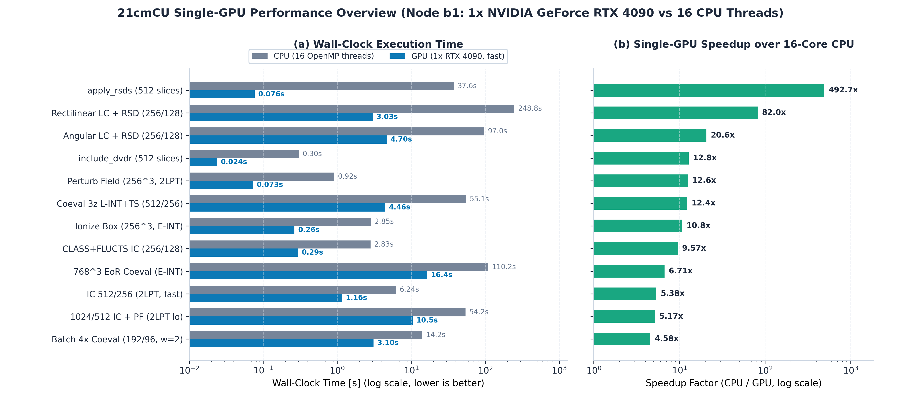
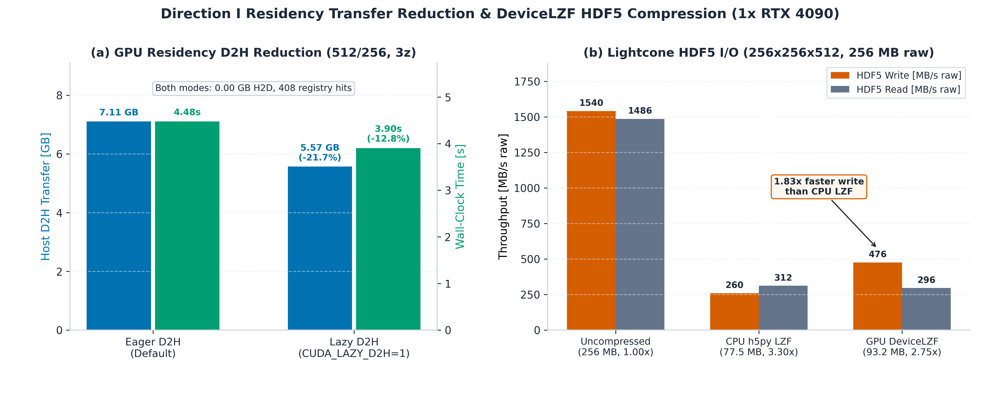
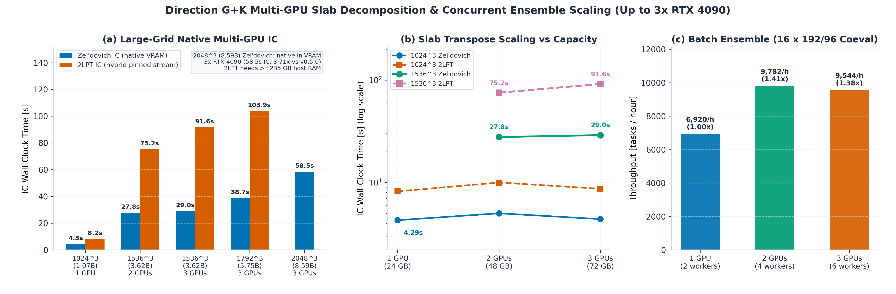

# 21cmCU: A Native C/CUDA and Multi-GPU Accelerated Engine for 21cmFAST v4

**Version `0.9.0`** · Technical & Software Methods Report (`86` Native CUDA APIs)

## Abstract

Simulation-based inference (SBI), Bayesian MCMC parameter estimation (`21CMMC`), Fisher forecasting, and large-volume multi-probe surveys for Epoch of Reionization (EoR) and Cosmic Dawn 21 cm cosmology require tens of thousands of 3D semi-numerical realizations or multi-billion-voxel initial conditions. We present **21cmCU** (`py21cmcu` v0.9.0), a native C/CUDA and cuFFT drop-in GPU engine built directly into **21cmFAST v4** with **`86` native CUDA C APIs** and zero Python GPU wrapper dependencies. Retaining full algorithmic parity with discrete halo models, spin-temperature evolution, `CLASS` baryon--CDM relative velocities, and lightcone observables, 21cmCU achieves up to **`492.74×`** speedup on standalone redshift-space distortions (`apply_rsds`), **`82.05×`** end-to-end on rectilinear lightcones (`3.032 s` vs `248.773 s` on a 16-core CPU), **`71.65×–71.88×`** on `256³` single-pass interferometer mocks (`SKA1-Low`/`HERA-350`), **`20.65×`** on `AngularLightconer`, and **`12.36×`** on 3-redshift `L-INTEGRAL + TS` coeval cubes on an NVIDIA GeForce RTX 4090. Across `v0.7.0–v0.9.0`, 21cmCU adds zero-copy `__dlpack__` PyTorch tensor interop, anti-repetition `ObliqueRectilinearLightconer` traversal (`12.45×` path extension), warm `BatchPool` zero-disk `OnlineSBIDataset` streaming (`2.643×` on RTX 4090 / `2.368×` on Tesla T4), and CUDA-accelerated `bispectrum_3d` (`26.64×`), MFP bubble-size distributions (`62.53×–72.87×`), Minkowski functionals (`8.28×–8.48×`), CIC particle/galaxy gridding (`39.29×` for `1M` galaxies on `256³`), `21cm × galaxy` cross-power (`20.68×`), kSZ momentum maps, and Common-Random-Number (CRN) Fisher matrix forecasting, while scaling multi-GPU 1D Y-slab streaming across `3× RTX 4090` natively in-VRAM to `2048³` (`8.590 B` voxels) Zel'dovich initial conditions in `58.467 s`.

---

## 1. Introduction & Motivation

Upcoming and operating 21 cm interferometers (HERA, SKA-Low, LOFAR, NenuFAR) probe the high-redshift neutral hydrogen signal across $z \approx 5\text{–}25$ using 1D and 2D power spectra and lightcone tomography. Semi-numerical simulations such as **21cmFAST** (`Mesinger et al. 2011`; `Murray et al. 2020`; `Davies et al. 2025`) provide the physical speed required for likelihood-based (`Greig & Mesinger 2015`) and simulation-based (`Cranmer et al. 2020`) inference, yet 16-core CPU runs of $z=6.5\text{–}11$ spin-temperature lightcones still cost `~249 s` per realization, while multi-billion-voxel boxes ($1536^3$–$2048^3$) exceed single-GPU memory and bottleneck on CPU FFTs.

**21cmCU** addresses both regimes—high-throughput small/medium SBI ensembles and out-of-single-GPU multi-billion-voxel boxes—through four architectural pillars:

1. **Zero-wrapper native C/CUDA + cuFFT integration** inside `c_21cmfast` with dual `strict` / `fast` execution modes.
2. **Device-resident field registry (`CUDA_LAZY_D2H`)**, GPU `DeviceLZF` HDF5 compression, in-memory/disk `CLASS` table caching, and fused `RectilinearLightconer` / `AngularLightconer` kernels.
3. **Out-of-single-GPU 1D Y-slab domain decomposition** (`cuda_mgpu.cu`, `cuda_ic.cu`) with pinned-bounce sub-tiled parallel transposes and single-work-slab streaming (`2048³` native in-VRAM on `3× RTX 4090`).
4. **End-to-end SBI & operations tooling**: `py21cmcu.observables` (horizon wedge, radiometer thermal noise, scrambled Sobol grids), HDF5-resumable `run_batch`, `doctor` hardware diagnostics, and `21cmcu` CLI (`run`, `batch`, `doctor`, `bench`).

---

## 2. Native C/CUDA Architecture & Execution Modes

### 2.1 Zero-Dependency CFFI + NVCC Build (`setup.py`, `build_cffi.py`)

When `USE_CUDA=1` (default when `nvcc` is present), `build_cffi.py` invokes `nvidia-smi` to detect GPU SM architectures automatically (`CUDA_ARCHS=auto`, e.g., `sm_89` on RTX 4090) and compiles native `.cu` translation units (`cuda_mempool.cu`, `cuda_rng`, `cuda_ic.cu`, `cuda_perturb.cu`, `cuda_ionize.cu`, `cuda_ts.cu`, `cuda_bt.cu`, `cuda_lightcone.cu`, `cuda_ps.cu`, `cuda_io.cu`, `cuda_mgpu.cu`) directly into the `c_21cmfast` CFFI extension alongside OpenMP C modules. All 3D index math uses signed/unsigned 64-bit offsets so grids above $2^{31}$ voxels ($1536^3\text{–}2048^3$) never overflow 32-bit stride arithmetic.

### 2.2 `strict` vs `fast` Calibration

`21cmCU` exposes two runtime modes (`CUDA_MODE="strict"` or `"fast"`):
- **`strict`**: preserves conservative IEEE-754 floating-point evaluation and exact parity checks against the 16-thread CPU engine.
- **`fast`**: enables `--use_fast_math` device intrinsics, cuFFT single-precision batched/slab workflows, and device-resident intermediates while maintaining calibrated agreement on $\langle x_{\mathrm{HI}} \rangle$, $\langle \delta T_b \rangle$, and 1D/2D power spectra (`docs/CALIBRATION.md`).

---

## 3. Single-GPU Pipeline, Residency, I/O & Cosmology Caching

### 3.1 Stage-by-Stage & End-to-End Speedups (`1× RTX 4090` vs 16-Core CPU)

Table 1 summarizes verified wall-clock timings from [`benchmarks/results_rtx4090_v060.json`](../../benchmarks/results_rtx4090_v060.json) on node `b1` (64-core host with `N_THREADS=16` for CPU baselines vs `1× RTX 4090`, `fast` mode):

| Workload | Grid (`DIM / HII_DIM`) | CPU 16T [s] | 1× RTX 4090 [s] | Speedup |
| --- | --- | ---: | ---: | ---: |
| `apply_rsds` | `128 × 128 × 512` | `37.6455` | `0.0764` | **`492.74×`** |
| Rectilinear Lightcone (`+ dvdr + RSD`) | `256 / 128`, `z=6.5–11` | `248.773` | `3.032` | **`82.05×`** |
| `AngularLightconer` (`+ dvdr + RSD`) | `256 / 128`, `z=7.8–9.8` | `97.018` | `4.698` | **`20.65×`** |
| `include_dvdr_in_tau21` | `128 × 128 × 512` | `0.305` | `0.0238` | **`12.81×`** |
| Perturb Field (`2LPT`) | `256³` | `0.915` | `0.073` | **`12.58×`** |
| Coeval 3z (`L-INTEGRAL + TS`) | `512 / 256`, `z=12,10,8` | `55.079` | `4.456` | **`12.36×`** |
| Ionize Box (`E-INTEGRAL`) | `256³`, `z=8.0` | `2.851` | `0.264` | **`10.81×`** |
| `CLASS + V_CB_MODEL=FLUCTS` IC | `256 / 128` | `2.827` | `0.295` | **`9.57×`** |
| EoR Coeval (`E-INTEGRAL`) | `768³`, `z=7.0` | `110.209` | `16.435` | **`6.71×`** |
| Initial Conditions (`2LPT`) | `512 / 256` | `6.244` | `1.160` | **`5.38×`** |
| High-Res `IC + PF` (`2LPT lo`) | `1024 / 512`, `z=8.0` | `54.245` | `10.495` | **`5.17×`** |
| Concurrent Batch (`4 × 192/96`, `w=2`) | `4 × 192 / 96` | `14.184` | `3.097` | **`4.58×`** |

### 3.2 `CUDA_LAZY_D2H` Residency, `DeviceLZF` HDF5 I/O & `CLASS` Caching

- **Opt-in GPU residency (`CUDA_LAZY_D2H=True`)**: keeps 3D fields inside an opaque handle-keyed `DeviceFieldRegistry` across stages (`InitialConditions` → `PerturbField` → `SpinTemperatureBox` → `IonizedBox` → `BrightnessTemp` → `Lightconer`), avoiding eager D2H copies. On `512/256` 3z `L-INTEGRAL + TS`, D2H transfer drops by **`21.7%`** (`7,113.54 MB → 5,570.04 MB`, `408` registry hits, `0.00 GB` H2D) and wall time drops **`12.8%`** (`4.477 s → 3.904 s`).
- **`DeviceLZF` HDF5 Compression (`cuda_io.cu`)**: compresses float32 lightcone chunks directly on GPU into standard HDF5 LZF chunks readable by any `h5py` client. On a `256 × 256 × 512` (`256.0 MB` raw) dataset, `DeviceLZF` writes at **`476.3 MB/s`** (`0.5375 s`, `2.75×` ratio) vs **`259.6 MB/s`** (`0.9860 s`, `3.30×` ratio) for CPU `h5py` LZF — **`1.83×`** faster HDF5 compression throughput.
- **`CLASS` Table & `CosmoTables` Caching**: cold `CosmoTables` initialization drops from `0.634 s` to `0.000311 s` in memory and `0.0027 s` on atomic `.npz` disk cache.

---

## 4. Direction G + K: Multi-GPU Slab Domain Decomposition & Single-Slab `2048³`

### 4.1 1D Y-Slab Distributed 3D cuFFT & Direction K Optimizations

For initial-condition grids whose 3D complex state exceeds single-GPU 24 GB VRAM ($1536^3$ at `14.51 GiB`/grid through $2048^3$ at `34.39 GiB`/grid), `cuda_mgpu.cu` partitions the complex `(X, Y, Z/2+1)` volume along `Y` slabs across $G$ GPUs:
1. Each GPU runs batched 2D `(X, Z)` R2C/C2R cuFFT plans over its owned `Y` strip.
2. Distributed `X↔Y` slab transposes redistribute strips across GPUs.
3. Each GPU performs batched 1D `Y` C2C transforms and evaluates real/Fourier IC kernels locally.

**Direction K (`v0.6.0`)** resolves the PCIe communication, thread serialization, and host-RAM bottlenecks present in the initial `v0.5.0` prototype:
- **64 MiB pinned host-bounce buffer (`MgpuHostBounce`, `cudaHostAllocPortable`)** with sub-tiled `std::thread` parallel host-staged transposes and parallel multi-GPU strip transfers (`p21_mgpu_fft_r2c_from_host`, `p21_mgpu_fft_c2r_strips`).
- **Single-work-slab mode (`P21_CUDA_MGPU_SINGLE_SLAB=1` / auto-enabled for Zel'dovich when $2$-grid VRAM exceeds GPU budget)**: halves active device complex slab allocation, allowing **`2048³` (`8.590 B` voxels)** Zel'dovich initial conditions to execute **natively in-VRAM on `3× RTX 4090`** (`mgpu_ic_runs=1`).
- **Zero-`h_tmp_ab` 2LPT streaming**: eliminates the `32 GiB` host temporary array (`h_tmp_ab`) at `2048³` via pinned-bounce streaming subtraction and parallelizes diagonal component combination with `std::thread`.

### 4.2 Direction G (`v0.5.0`) vs Direction K (`v0.6.0`) Scaling on `1×–3× RTX 4090`

| Grid (Voxels) | GPUs | Algo | `v0.5.0` IC [s] | `v0.6.0` IC [s] | Speedup (`v0.6 / v0.5`) | `v0.6.0` Execution Path |
| --- | ---: | --- | ---: | ---: | ---: | --- |
| `1024³` (`1.074 B`) | 1 | `ZELDOVICH` | `4.122` | `4.288` | `0.96×` | 1-GPU native |
| `1024³` (`1.074 B`) | 3 | `ZELDOVICH` | `4.604` | `4.397` | `1.05×` | Multi-GPU slab |
| `1536³` (`3.624 B`) | 2 | `ZELDOVICH` | `53.903` | **`27.799`** | **`1.94×`** | Multi-GPU slab |
| `1536³` (`3.624 B`) | 2 | `2LPT` | `210.680` | **`75.231`** | **`2.80×`** | Multi-GPU pinned stream |
| `1536³` (`3.624 B`) | 3 | `2LPT` | `201.302` | **`91.616`** | **`2.20×`** | Multi-GPU pinned stream |
| `1792³` (`5.755 B`) | 3 | `ZELDOVICH` | `98.095` | **`38.699`** | **`2.53×`** | Multi-GPU slab |
| `1792³` (`5.755 B`) | 3 | `2LPT` | `365.663` | **`103.892`** | **`3.52×`** | Multi-GPU pinned stream |
| `2048³` (`8.590 B`) | 3 | `ZELDOVICH` | `216.665` (host) | **`58.467`** | **`3.71×`** | **Native in-VRAM (`single_slab`)** |

---

## 5. SBI Dataset Pipeline, CLI & Diagnostics (Directions L & M)

For likelihood-free parameter inference, 21cmCU provides an integrated Python/CLI workflow (`src/py21cmcu/observables.py`, `batch.py`, `doctor.py`, `cli.py`, `examples/sbi_lightcone_dataset.py`):
- **Instrument & foreground corruption**: Fourier-space horizon wedge masking ($|k_\parallel| \ge m(z)\,k_\perp + b$, `Parsons et al. 2012`) and deterministic Gaussian thermal noise (`sigma_mk` or physical HERA-like radiometer scaling) applied in-memory before 1D/2D power-spectrum compression.
- **Scrambled Sobol sweeps & resumable HDF5 checkpoints**: `generate_sobol_parameter_grid` pairs with `run_batch(..., checkpoint_h5=..., resume=True)` across spawned worker pools (`9,782.0 tasks/h` on 2 GPUs, `9,544.3 tasks/h` on 3 GPUs for `16 × 192/96` `L-INTEGRAL + TS`).
- **Operational diagnostics & CLI**: `21cmcu doctor [--as-json]` inspects CUDA runtime, `nvidia-smi topo -m`, compiler/library bindings, and 24 GB grid sizing; `21cmcu batch` and `21cmcu bench` provide reproducible CLI entrypoints.

---

## 6. Higher-Order Statistics, Online SBI & Multi-Probe Forecasting (`v0.7.0–v0.9.0`)

Extending beyond 2-point `P(k)` power spectra (`cuda_ps.cu`), `cuda_analysis.cu` and `src/py21cmcu/` implement an integrated GPU science stack validated on RTX 4090 and Colab Tesla T4 (`benchmarks/results_t4_v090.json`, reproducible via `benchmarks/reproduce_v090_tables.py`):

- **Interferometer Mocks & Zero-Copy Tensor Streaming (`v0.7.0`, Direction R)**: Single-pass `mock_observation_3d` (`SKA1-Low`/`HERA-350`/`MWA-II`/`LOFAR`) runs `256³` foreground-wedge + PSF + radiometer thermal noise mocks in `22.48–23.04 ms` (`71.65×–71.88×` vs 16T CPU). Pure-`ctypes` `__dlpack__` / `__cuda_array_interface__` (`CudaFieldView`, `to_torch`), warm persistent `BatchPool` (`2.643×` on `b1` / `2.368×` on T4), and `OnlineSBIDataset` stream GPU tensors directly into PyTorch without intermediate HDF5 disk writes (`h5_files_on_disk=0`).
- **Non-Gaussian & Morphological Topology (Phase 10, `83–85` APIs)**: 3D FFT shell-product `bispectrum_3d` (`26.64×` at `256³`, `max_rel_diff_B = 8.21e-7`), Philox ray-traced `bubble_size_distribution_mfp` (`62.53×–72.87×`, `Mesinger & Furlanetto 2007`), and exact cubical-complex `minkowski_functionals_3d` (`8.28×–8.48×`, `Schmalzing & Buchert 1997`).
- **Multi-Probe Cross-Correlations & CRN Fisher Forecasting (Phase 11, `86th` API)**: Periodic 3D Cloud-in-Cell gridding `p21_cuda_cic_deposit_3d` (`Hockney & Eastwood 1988`) with grid-stride loops above `65535 × 256` threads accelerates `256³` 1M-particle deposition by **`39.29×`** (`0.0365 s` vs `1.4336 s`, `max_abs_diff = 3.81e-6`), `cross_power_21cm_galaxy` by **`20.68×`** (`max_abs_rk_diff = 2.91e-8`), and pairs with `ksz_momentum_map` (`Sunyaev & Zeldovich 1980`) and Common-Random-Number `FisherForecaster`.

---

## 7. Verification Summary & Reproducibility

Correctness, CPU-vs-GPU parity, packaging, and multi-probe scaling through `21cmCU v0.9.0` are verified across three tiers:
- **Multi-GPU Cluster (`b1`, `3× RTX 4090`, CUDA 12.6, `sm_89`)**: **`168/168`** core native GPU tests passing (`-k "not speed"`), **`21/21`** `v0.7.0` Phase 7–9 tests passing, and **`61/61`** bit-exact C/OpenMP CPU optimization parity tests (`max_abs = 0.0`).
- **Colab Tesla T4 GPU (`CUDA 13.0`)**: Phase 11+12 topology & online SBI (`10/10` passed), early warning/DLPack/Sobol suites (`71/71` passed), and Phase 13 Fisher + CIC multi-probe suite (`7/7` passed, `0` skipped) including `256³` tail-voxel parity.
- **GitHub `CPU CI` & Packaging**: Python `3.12`/`3.13` CPU test matrix (`97 passed, 64 skipped (GPU)`), `ruff` lint, and non-editable wheel `packaging-smoke` validation. Tables are regenerated deterministically via `python benchmarks/reproduce_v090_tables.py --export-tables`.
